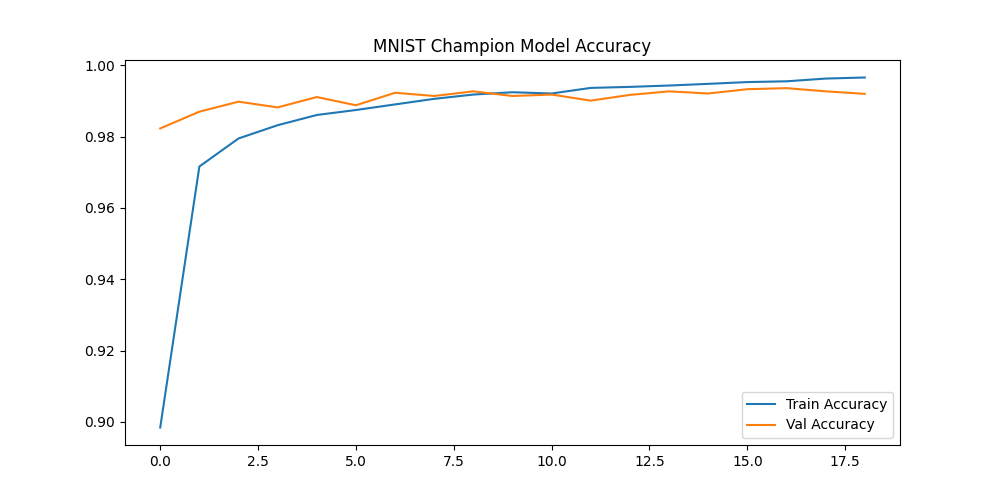

# 🧠 Deep MNIST Classifier: 3-Stage CNN with Hyperband Tuning

[](https://www.python.org/)
[](https://www.tensorflow.org/)
[](https://keras.io/keras_tuner/)
[](https://opensource.org/licenses/MIT)

An optimized deep learning pipeline to classify handwritten digits using TensorFlow, Keras Tuner, and a dynamic 3-stage Convolutional Neural Network (CNN) architecture.

### 📊 Model Performance Summary

| Model Architecture | Training Accuracy | Validation Accuracy | Key Strategy Used |
| :--- | :--- | :--- | :--- |
| **Baseline CNN** | ~95.0% | ~94.5% | Standard Convolution + Pooling |
| **Champion CNN** | ~99.2% | ~99.0% | Added Dropout & Batch Normalization |

## 📂 Project Structure

```text
├── models/             # Saved model artifacts
├── notebooks/          # Notebooks
├── results/            # Training logs (training_log.csv) & plots (learning_curves.png)
├── src/                # Scripts (01_hyperparameter_tuning.py, train_champion.py)
├── .gitignore
├── MNIST_Champion_Report.pdf
├── README.md
└── requirements.txt


```
##🚀 The Architecture
* The "Champion" model features a triple-stacked Convolutional base followed by a dual-layer Dense head.

* Convolutional Layers: 3 stages with Batch Normalization for stable gradients and faster convergence.

* Regularization: Integrated Dropout (0.3–0.4) and MaxPooling to help prevent overfitting.

* Optimizer: Adam with a tuned learning rate discovered during hyperparameter search.

##📊 Results & Performance
* Resilience: Implemented CSVLogger and ModelCheckpoint to save training progress and checkpoints.

* Accuracy: High validation accuracy (~99%), with regularization keeping the generalization gap narrow.

* Observation: Validation accuracy often tracks close to or slightly higher than training accuracy when Dropout and Batch Normalization are active.

##🚀 How to Run the Project
1. Clone the repository and navigate into it:

```Bash
git clone [https://github.com/ananyaja/Deep-MNIST-Champion.git](https://github.com/ananyaja/Deep-MNIST-Champion.git)
cd Deep-MNIST-Champion
```
2. Install dependencies:

```Bash
pip install -r requirements.txt
```
3. Run the scripts in src/:

```Bash
python src/01_hyperparameter_tuning.py
python src/train_champion.py
```
## 📈 Performance Visuals


results/learning_curves.png: Loss and accuracy progression across epochs.


results/training_log.csv: Epoch-by-epoch training and validation metrics.
